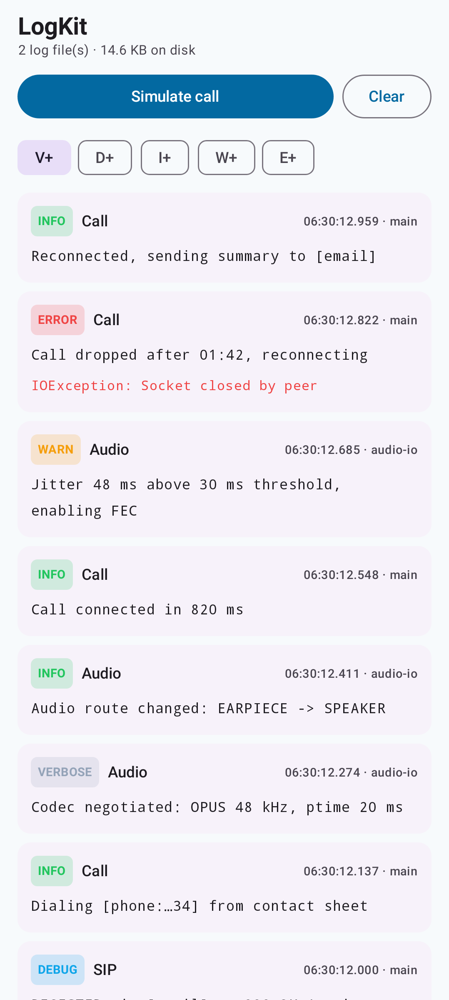
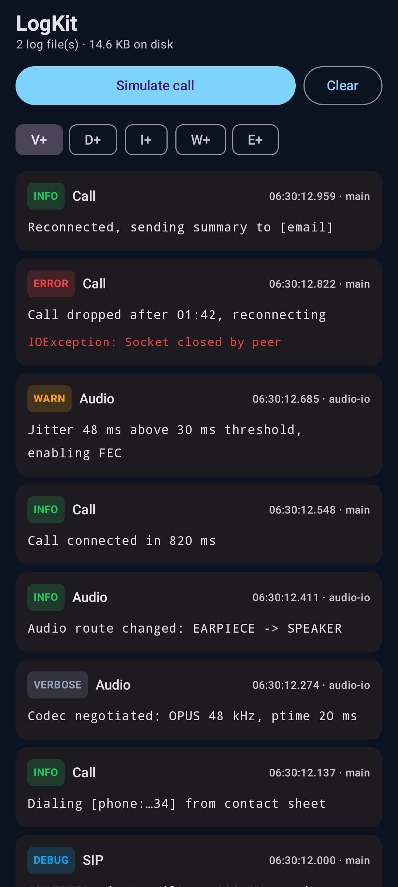
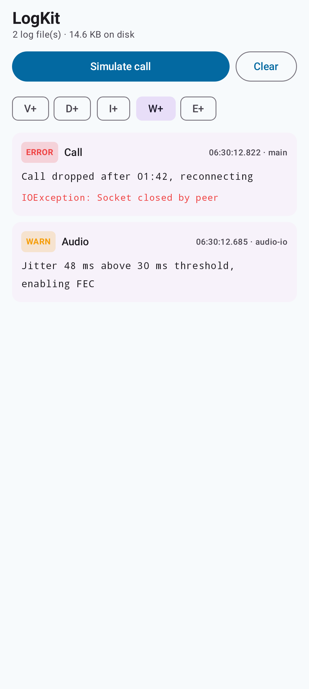

# LogKit · reusable Android logging library (AAR)

[](https://github.com/gayatripatel10091992/android-logkit/actions/workflows/ci.yml)
[](https://jitpack.io/#gayatripatel10091992/android-logkit)


A small logging library for Android apps, published as an **AAR with Maven Publish** (GitHub Packages and JitPack).
I built it to show how I package reusable code for several apps: a clean public API (`explicitApi()`),
no reflection, no heavy dependencies, unit-tested, plus a sample app.

## Features

- **Pluggable sinks:** Logcat (handles long messages), **rolling files** (size-based rotation off the main thread), and an **in-memory ring buffer** exposed as a `StateFlow` for an in-app log viewer or support screen
- **PII redaction before any sink:** e-mails, bearer tokens and phone numbers are masked (`+1 415 555 0134` → `[phone:…34]`), while dates and durations are left alone
- **Zero cost when disabled:** messages are lambdas, so nothing is built below `minLevel`
- **Fail-safe:** a crashing sink never crashes the app or blocks the other sinks
- **minSdk 21**, consumer ProGuard rules included, sources JAR published

## Screenshots (sample app)

Rendered by CI with Robolectric + Roborazzi. The messages pass through the real `PiiRedactor`.

| Log viewer | Dark | Warnings and errors only |
|---|---|---|
|  |  |  |

## Usage

```kotlin
class App : Application() {
    override fun onCreate() {
        super.onCreate()
        LogKit.install {
            minLevel = if (BuildConfig.DEBUG) LogLevel.VERBOSE else LogLevel.INFO
            sink(LogcatSink())
            sink(RollingFileSink(File(filesDir, "logs"), maxFileBytes = 512 * 1024, maxFiles = 3))
        }
    }
}

private val log = LogKit.logger("Billing")

log.i { "Purchase acknowledged for $productId" }
log.e(exception) { "Subscription renewal failed" }
```

Custom sink (for example, forwarding errors to Crashlytics):

```kotlin
LogKit.install {
    sink { entry ->
        if (entry.level >= LogLevel.ERROR) crashlytics.log("${entry.tag}: ${entry.message}")
    }
}
```

## Install

**JitPack** (no token needed):

```kotlin
// settings.gradle.kts
dependencyResolutionManagement { repositories { maven("https://jitpack.io") } }

// build.gradle.kts
implementation("com.github.gayatripatel10091992:android-logkit:v1.0.0")
```

**GitHub Packages:**

```kotlin
repositories {
    maven("https://maven.pkg.github.com/gayatripatel10091992/android-logkit") {
        credentials {
            username = providers.gradleProperty("gpr.user").get()
            password = providers.gradleProperty("gpr.key").get() // PAT with read:packages
        }
    }
}
implementation("io.github.gayatripatel10091992:logkit:1.0.0")
```

## Project structure

| Module | What |
|---|---|
| `:logkit` | The library (Android library + `maven-publish`, `explicitApi()`, unit tests) |
| `:sample` | Compose sample app with an in-app log viewer driven by `RingBufferSink` |

## Release process

1. CI (`ci.yml`) runs unit tests, Android Lint, builds the release AAR, verifies the Maven publication, builds the sample and refreshes screenshots.
2. Pushing a tag `vX.Y.Z` runs `publish.yml`, which publishes `io.github.gayatripatel10091992:logkit:X.Y.Z` to GitHub Packages. JitPack builds the same tag on demand.

## License

MIT © Gayatri Patel
